# DevTITANS 09 – Hands-On Final – Equipe 03: Joystick SNES na Raspberry Pi controlando um braço robótico

Um joystick feito pela equipe (ESP32 + botões + analógico + acelerômetro, no protocolo do controle do Super
Nintendo) conversa por **Bluetooth** com uma **Raspberry Pi 4 rodando Android (AOSP/GloDroid)**. Na Raspberry,
dois drivers transformam o controle num gamepad do Android e repassam os botões por **USB** ao **ESP32 do braço
robótico**, que move os 4 servos.

**Estado:** a cadeia completa foi apresentada funcionando em 11/11/2026: joystick → Raspberry → ESP32 do braço
→ servos.

- [Como funciona](#como-funciona)
- [O que está neste repositório](#o-que-está-neste-repositório)
- [Hardware](#hardware)
- [Colocar para rodar](#colocar-para-rodar)
- [Testes](#testes)
- [Documentação](#documentação)
- [Equipe](#equipe)
- [Histórico e decisões](#histórico-e-decisões)

## Como funciona

```mermaid
flowchart LR
    J["Joystick<br/>ESP32 + botões + analógico + acelerômetro<br/>(SNES_BT_Controller/)"]
    subgraph RPI["Raspberry Pi 4 · Android 14 (GloDroid)"]
        A["App com.snesbt.receiver<br/>(app/)"]
        D1["snes_input_daemon<br/>driver do Raphael (daemon/)"]
        G["gamepad SNES-BT-Controller<br/>/dev/input/eventN"]
        D2["snes_arm_daemon<br/>driver do braço (braco/daemon/)"]
    end
    E["ESP32 do braço<br/>firmwareBraco.ino (FirmawareBraco/)"]
    S["4 servos SG90<br/>base · ombro · cotovelo · garra"]

    J -- "Bluetooth LE<br/>quadro de 8 bytes" --> A
    A -- "LocalSocket<br/>@snesbt_input" --> D1
    D1 -- uinput --> G
    G -- evdev --> D2
    D2 -- "USB serial 115200<br/>1 linha de texto a cada 30 ms" --> E
    E -- PWM 50 Hz --> S
```



1. **Joystick:** o firmware lê os botões, o analógico e o acelerômetro e monta o "registrador" de 16 bits do
   controle SNES (bit 0 = pressionado). Ele envia esse registrador num quadro de 8 bytes
   (`53 4E 01 01 seq lo hi CRC-8`) pelo Bluetooth LE.
2. **App Android:** procura o `SNES-BT-Controller`, conecta, valida cada quadro (sincronismo, versão e CRC) e o
   repassa ao driver pelo `LocalSocket`.
3. **`snes_input_daemon` (driver do Raphael):** cria pelo `uinput` um gamepad de verdade no Android,
   o `SNES-BT-Controller`. Qualquer app ou jogo pode usá-lo, e ele solta os botões se o app parar de mandar.
4. **`snes_arm_daemon` (driver do braço):** lê esse gamepad, remonta os 16 bits e manda ao ESP32 do braço pela
   serial USB. Enquanto há botão apertado, envia uma linha de texto a cada 30 ms com o número decimal dos botões
   pressionados (`256` = A). Solto, não envia nada, e o braço para.
5. **ESP32 do braço (firmware do William):** lê uma linha a cada 25 ms e anda 1° por botão:

| Botão | Braço | | Botão | Braço |
|---|---|---|---|---|
| ← / → | gira a base | | B / Y | sobe / desce o cotovelo |
| ↑ / ↓ | sobe / desce o ombro | | A / X | abre / fecha a garra |

## O que está neste repositório

| Pasta | O quê | Quem |
|---|---|---|
| [`SNES_BT_Controller/`](SNES_BT_Controller) | Firmware do **joystick** (ESP32, Arduino): botões, analógico, acelerômetro, BLE, quadro SNES | Raphael |
| [`app/`](app) | **App Android** receptor BLE → daemon (Java, Gradle) | Raphael |
| [`daemon/`](daemon) | **`snes_input_daemon`**: cria o gamepad no Android (C++, NDK) | Raphael |
| [`scripts/`](scripts) | `deploy.sh` (instala app + daemon) e `device_test.py` do lado do joystick | Raphael |
| [`docs/`](docs) | Protocolo do joystick, IPC app ↔ daemon, decisões e operação | Raphael |
| [`braco/`](braco) | **`snes_arm_daemon`**: driver do braço, com testes, simulador, scripts e documentação | Caio |
| [`braco/GUIA_WILLIAM.md`](braco/GUIA_WILLIAM.md) | **Guia completo da parte do braço**: o que roda, protocolo, testes e possíveis ajustes | Caio |
| [`FirmawareBraco/`](FirmawareBraco) | Firmware do **ESP32 do braço** (`firmwareBraco.ino`, biblioteca ESP32Servo) | William |
| [`resources/`](resources) | Esquemas, diagrama de controle e fluxograma dos servos | William |

O histórico de cada parte está nas branches de origem, que continuam no repositório: `driver`, `firmware`,
`FirmwareBraco` e `integracao-braco`. A `main` junta todas elas.

## Hardware

| Parte | Itens |
|---|---|
| Raspberry | Raspberry Pi 4 Model B (4 GB ou mais), microSD de 32 GB ou mais, fonte USB-C de 15 W. Imagem **GloDroid (AOSP, Android 14) `userdebug`** |
| Joystick | ESP32 DevKit, joystick analógico, 6 botões (com resistor de 10 kΩ e capacitor 104 cada), acelerômetro, case impresso em 3D |
| Braço | Braço de acrílico estilo MeArm com **4 servos SG90**, **ESP32 com chip USB CP2102** (CH340 não funciona: o kernel da Raspberry não tem driver para ele), **fonte 5 V externa de 3 a 5 A** com GND ligado ao do ESP32 |

Pinos do ESP32 do braço: **base 13, ombro 14, cotovelo 18, garra 26**.

## Colocar para rodar

### Uma vez: gravar e instalar

1. **Imagem da Raspberry:** compile e grave a GloDroid seguindo as páginas da [Wiki](../../wiki) (issues 1.1 e
   1.2).
2. **Firmware do joystick:** Arduino IDE, abra `SNES_BT_Controller/SNES_BT_Controller.ino`, placa **ESP32 Dev
   Module**, e grave.
3. **Firmware do braço:** Arduino IDE com a biblioteca **ESP32Servo**, abra `FirmawareBraco/firmwareBraco.ino`,
   placa **ESP32 Dev Module**, e grave. Ligue esse ESP32 numa USB-A da Raspberry.
4. **App e driver do joystick** (no computador, com a Raspberry no USB-C e o `adb` funcionando):
   ```bash
   scripts/deploy.sh
   ```
5. **Driver do braço** (no Windows, use o Git Bash; precisa do NDK do Android Studio):
   ```bash
   sh braco/scripts/deploy.sh
   ```
   Isso também envia o `rasp_start.sh` para a Raspberry.

### A cada vez que a Raspberry liga

Os arquivos ficam instalados, mas **os dois drivers não sobem sozinhos**. Só o app sobe. Um comando religa tudo:

```bash
adb shell sh /data/local/tmp/rasp_start.sh
```

Ele sobe o driver do Raphael (se ainda não estiver rodando), o serviço do app e o driver do braço como root,
e mostra o começo do log. Depois, ligue o joystick: o app conecta sozinho.

### Ver funcionando

```bash
adb logcat -s SnesBtReceiver SnesDaemon SnesArmDaemon
```

Para cada botão aparecem, em sequência: o app recebendo (`SnesBtReceiver: estado 0xFEFF [A]`), o driver do braço
lendo (`SnesArmDaemon: estado 0xFEFF (evento)`) e o ESP32 respondendo (`esp32: BTN_A`).

**Sem o ESP32 do braço**, o simulador mostra o braço se mexendo no navegador, com o mesmo comportamento do
firmware do William. Veja a seção 6.1 do [guia](braco/GUIA_WILLIAM.md).

Se algo não funcionar, a seção 7.2 do [guia](braco/GUIA_WILLIAM.md) cobre os casos que já apareceram: reboot,
joystick desconectado e `Permission denied`.

## Testes

| Teste | Comando | Resultado registrado |
|---|---|---|
| Driver do Raphael (host) | `daemon/test.sh` | 56 verificações ✅ |
| App (JVM) | `./gradlew :app:testDebugUnitTest` | não rodado na integração do braço |
| Driver do braço (unitários, rodando na Raspberry) | ver `braco/daemon/tests/` | 61/61 ✅ |
| Integração dos dois drivers na Raspberry (protocolos frame e william) | `python braco/scripts/device_test.py` | 19/19 ✅ |
| Joystick real → Raspberry → ESP32 do braço real | logcat acima | ✅ 11/11 |

## Documentação

| Assunto | Onde |
|---|---|
| Parte do braço, completa (comece por aqui) | [`braco/GUIA_WILLIAM.md`](braco/GUIA_WILLIAM.md) |
| Tutorial rápido do braço, opções e protocolo serial | [`braco/TUTORIAL.md`](braco/TUTORIAL.md), [`braco/docs/`](braco/docs) |
| Protocolo do joystick (quadro BLE) e IPC app ↔ daemon | [`docs/protocol_spec.md`](docs/protocol_spec.md), [`docs/ipc_spec.md`](docs/ipc_spec.md) |
| Operação e diagnóstico do lado do joystick | [`docs/OPERACAO.md`](docs/OPERACAO.md) |
| Relatórios semanais, compilação do AOSP e comandos | [Wiki](../../wiki) |
| Board do projeto (18 atividades) e issues | Branch [`backup-github`](../../tree/backup-github): `board/BOARD.md` e `issues/ISSUES.md` |

O `README_TESTE_END_TO_END.md` é o pacote de teste original do joystick. Alguns caminhos dele (`ble/`,
`receiver/`) são de antes da organização atual das pastas.

## Equipe

**Equipe Raspberry**
- **Thiago Pereira Lopes Chaves:** repositório; instalação e configuração do AOSP (GloDroid) na Raspberry Pi.

**Equipe Joystick**
- **Laura Nunes Belém:** confecção do joystick e firmware.
- **Raphael Vasconcelos Nunes de Mello:** firmware BLE do joystick, app receptor e driver `snes_input_daemon`.

**Equipe Robô**
- **Laura Nunes Belém:** confecção do braço robótico.
- **William Roberto dos Santos Pereira:** comunicação Raspberry × braço; firmware do ESP32 do braço.
- **Caio Cesar Faneco Gonzaga:** comunicação Raspberry × braço; driver `snes_arm_daemon`, testes e documentação
  da integração.

Contato do projeto original: [thiago.chaves@icomp.ufam.edu.br](mailto:thiago.chaves@icomp.ufam.edu.br).

## Histórico e decisões

- **Plano inicial:** joystick por cabo USB e driver como módulo de kernel (`snes_joystick_driver.ko`). Isso foi
  substituído por **Bluetooth LE + app + `uinput`**, que não exige recompilar o kernel da imagem. Os motivos estão
  em [`docs/DECISOES.md`](docs/DECISOES.md).
- **Braço:** a Raspberry não gera o PWM dos servos. O ESP32 do braço faz isso, e a Raspberry só manda os botões
  pela USB. Assim o PWM sai sem tremida e o braço para sozinho se a Raspberry travar. Detalhes em
  [`braco/docs/DECISOES.md`](braco/docs/DECISOES.md).
- **Formato Raspberry → braço:** o driver do braço fala o formato do firmware do William (texto decimal, 1 linha
  a cada 30 ms). Também aceita o quadro binário do joystick (`--protocolo frame`), usado pelo firmware alternativo
  em `braco/firmware_esp32/` e pelo simulador.
- **Pendências conhecidas** (seção 8 do [guia](braco/GUIA_WILLIAM.md)):
  - às vezes o joystick parado manda ↓/←, o que pede calibração do analógico ou do acelerômetro;
  - falta calibrar os limites dos servos no braço montado;
  - para os drivers subirem sozinhos no boot, é preciso incluí-los na imagem (`braco/aosp/`).
